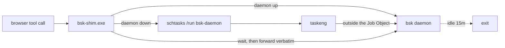

# dsh-bsk-daemon

**Make [BrowserSkill](https://github.com/Tencent/BrowserSkill)'s `bsk` daemon start on demand and exit when idle inside [DeepSeek Harness](https://github.com/deepseek-ai/deepseek-harness) — and fix the Windows `os error 5` that stops it from starting at all.**

[](LICENSE)


```sh
dsh plugin --profile desktop add github:like999888999-ui/dsh-bsk-daemon
```

---

## The problem

`browser-skill` drives a local `bsk` daemon. Either that daemon stays resident forever (wasting a few hundred MB) or `bsk` starts it on demand. The on-demand path is **broken inside DSH on Windows**:

```
automatic daemon startup failed: cannot start an independent Windows daemon;
the host may prohibit Job Object breakaway; ...
Access is denied. (os error 5)
```

The DSH host runs inside a Windows **Job Object** that forbids detached children. The very first browser tool call therefore fails, with no hint about what went wrong or how to fix it.

## How it works

A scheduled task is the one process shape that can escape the host's Job Object: tasks are spawned by `taskeng`, not by the host. This plugin puts a tiny wake shim in front of `bsk` and lets a trigger-less scheduled task own the daemon.



The result: **nothing resident while idle, automatic start when used, automatic exit after the idle timeout.**

## Quick start

```sh
# 1. this plugin
dsh plugin --profile desktop add github:like999888999-ui/dsh-bsk-daemon

# 2. browser-skill, if you have not installed it yet
dsh plugin --profile desktop add @wxg-prc-cpg/browser-skill-dsh-plugin

# 3. fully quit dsh and start it again
```

The first load runs setup once: it builds the shim and registers the scheduled task. Then point `browser-skill` at the shim — add this to the profile's `cordis.patch.yml` (`~/.dsh/profiles/desktop/cordis.patch.yml`):

```yaml
- id: browserskill
  config:
    bskPath: 'C:\Users\<you>\.local\bin\bsk-shim.exe'
```

Restart the host. Every browser tool call now handles the daemon lifecycle transparently.

> **Don't want to touch `bskPath`?** Leave it alone and call `bsk_wake` once before a batch of browser work. Same effect, one extra step.

### Verify it worked

Ask the agent to call `bsk_status`. A healthy install returns:

```json
{
  "platform": "win32",
  "strategy": "windows-task",
  "bskExists": true,
  "shimExists": true,
  "taskExists": true,
  "running": false,
  "pid": null
}
```

`running: false` while idle is **correct** — that is the whole point. Trigger a browser call and it becomes `running: true` with a `pid`.

## Tools

| Tool | Purpose |
| :-- | :-- |
| `bsk_status` | Daemon state, connected browsers, shim and task status |
| `bsk_setup` | Rebuild the shim and re-register the task (idempotent; run after upgrading `bsk`) |
| `bsk_wake` | Start the daemon if down and wait until it answers |
| `bsk_stop` | Stop now instead of waiting out the idle timeout |

## Configuration

Set in the profile's `cordis.patch.yml` under `id: bsk-daemon`, or from the settings page.

| Field | Default | Meaning |
| :-- | :-- | :-- |
| `bskPath` | empty (auto-detect) | Path to the `bsk` binary. Empty tries `~/.local/bin/bsk.exe`, `~/.cargo/bin/bsk`, then `PATH` |
| `taskName` | `bsk-daemon` | Scheduled task name |
| `daemonIdle` | `15m` | How long the daemon stays alive while idle |
| `sessionIdle` | `5m` | Per-session idle timeout |
| `autoSetup` | `true` | Run setup once at plugin load |
| `autoWake` | `true` | Pre-warm the daemon before a browser tool runs |
| `shimPath` | empty (`~/.local/bin/bsk-shim.exe`) | Where to build the shim |

```yaml
- id: bsk-daemon
  config:
    daemonIdle: 30m
    autoWake: false
```

## Platform notes

| Platform | Wake mechanism | Why |
| :-- | :-- | :-- |
| Windows | Scheduled task + shim | Job Object restriction makes a detached spawn impossible |
| macOS / Linux | Plain detached process | No restriction, no shim needed |

On non-Windows platforms the plugin only provides the status and lifecycle tools; no shim or task is created.

## Troubleshooting

### The plugin is loaded but none of the `bsk_*` tools exist

This was a real bug in `0.1.0`, fixed in `0.1.1`. A plugin that calls `ctx.tools.register` **must** declare the service in `inject`:

```js
export const inject = ['tools']
```

Without it the host mounts the plugin before the tool registry exists, `ctx.tools` is `undefined`, and every registration throws inside `apply()`. Because the mount path swallows plugin errors, the plugin still reports as loaded — it just exposes zero tools and no error. Any plugin registering tools is subject to this.

### `os error 5` / `Access is denied` on the first browser call

Either the shim is not wired up (`bskPath` still points at `bsk.exe`), or the scheduled task is missing. Run `bsk_setup`, then check `bsk_status` reports `shimExists: true` and `taskExists: true`.

### The daemon never exits

Something else is holding a session open. Check `bsk_status` → `browsers[].session_count`; a stale session keeps the daemon alive until `sessionIdle` elapses.

### `csc.exe` not found during setup

The shim is compiled with the in-box .NET Framework compiler. On a stripped Windows install you may need the .NET Framework developer pack. This is build-time only — an already-built shim is a standalone exe.

## Manual shim build (without the plugin)

```sh
git clone https://github.com/like999888999-ui/dsh-bsk-daemon
cd dsh-bsk-daemon
node lib/shim/build-shim.mjs --bsk "C:\Users\you\.local\bin\bsk.exe" --task bsk-daemon
```

Then register the task yourself, or let the plugin do it.

## Requirements

- Node.js ≥ 22.13.0
- The `bsk` CLI — see the [BrowserSkill quick start](https://github.com/Tencent/BrowserSkill#quick-start)
- On Windows, the in-box .NET Framework compiler `csc.exe` (present on Windows 8 and later; nothing to download)

## Uninstall

```sh
dsh plugin --profile desktop remove dsh-bsk-daemon
schtasks /Delete /TN bsk-daemon /F
```

You can also delete `bsk-daemon-launch.vbs` and `bsk-daemon.xml` from `~/.bsk/`.

## Limitations

- **Windows-specific problem.** On macOS and Linux this mechanism is unnecessary — harmless, just unused.
- **Cold start costs ~4–8 s.** The first call after the daemon exits waits for it to come up. Subsequent calls in the same window are effectively free.
- **`csc.exe` is a build-time dependency only.** Once built, the shim is a standalone exe.
- **Does not install the browser extension.** BrowserSkill's Chrome/Edge extension must be installed from the store by hand — browsers do not allow programmatic extension installs.

## License

MIT. See [LICENSE](LICENSE).
