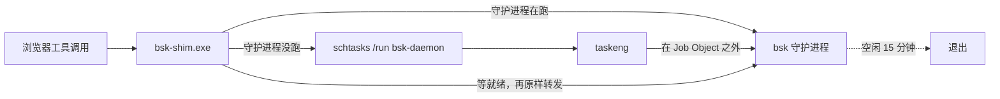

# dsh-bsk-daemon

**让 [BrowserSkill](https://github.com/Tencent/BrowserSkill)（`bsk`）的守护进程在 [DeepSeek Harness](https://github.com/deepseek-ai/deepseek-harness) 里按需唤醒、空闲退出 —— 并修掉 Windows 上它根本起不来的 `os error 5`。**

[](LICENSE)


```sh
dsh plugin --profile desktop add github:like999888999-ui/dsh-bsk-daemon
```

---

## 它解决什么问题

`browser-skill` 插件驱动一个本地 `bsk` 守护进程。这个进程要么常驻（吃掉几百 MB 内存），要么在需要时由 `bsk` 自己拉起。而后者在 **DSH 的 Windows 宿主里是坏的**：

```
automatic daemon startup failed: cannot start an independent Windows daemon;
the host may prohibit Job Object breakaway; ...
拒绝访问。 (os error 5)
```

原因是 DSH 宿主进程被包在 Windows **Job Object** 里，子进程不允许脱离。于是你第一次调用浏览器工具就直接失败，而且报错里完全看不出该怎么修。

## 它怎么做的

计划任务是唯一能逃出宿主 Job Object 的进程形态：任务由 `taskeng` 派生，不归宿主管。本插件在 `bsk` 前面垫一个极小的唤醒 shim，并让一条**无触发器**的计划任务持有守护进程。



结果：**平时不占内存，用到时自动起来，用完按空闲超时自己退出。**

## 快速开始

```sh
# 1. 装本插件
dsh plugin --profile desktop add github:like999888999-ui/dsh-bsk-daemon

# 2. 装 browser-skill（如果还没装）
dsh plugin --profile desktop add @wxg-prc-cpg/browser-skill-dsh-plugin

# 3. 完全退出 DSH 再打开
```

首次加载会自动执行一次 setup：编译 shim、注册计划任务。然后把 `browser-skill` 指向 shim —— 在 profile 的 `cordis.patch.yml`（`~/.dsh/profiles/desktop/cordis.patch.yml`）里加：

```yaml
- id: browserskill
  config:
    bskPath: 'C:\Users\<你>\.local\bin\bsk-shim.exe'
```

重启宿主后生效。之后所有浏览器工具调用都会自动处理守护进程的启停。

> **不想动 `bskPath`？** 那就保持原样，在每轮浏览器操作前先调用一次 `bsk_wake`。效果一样，只是多一步。

### 确认装好了

让 agent 调一下 `bsk_status`。健康状态下会返回：

```json
{
  "platform": "win32",
  "strategy": "windows-task",
  "bskExists": true,
  "shimExists": true,
  "taskExists": true,
  "running": false,
  "pid": null
}
```

空闲时 `running: false` 是**正常的** —— 这正是本插件的目的。发起一次浏览器调用后它会变成 `running: true` 并带上 `pid`。

## 提供的工具

| 工具 | 作用 |
| :-- | :-- |
| `bsk_status` | 守护进程状态、已连接的浏览器、shim 与计划任务状态 |
| `bsk_setup` | 重新编译 shim 并注册计划任务（幂等；升级 `bsk` 后运行） |
| `bsk_wake` | 守护进程没跑就启动，并等它就绪 |
| `bsk_stop` | 立即停掉，不等空闲超时 |

## 配置

写在 profile 的 `cordis.patch.yml` 里（`id: bsk-daemon`），或用设置页。

| 字段 | 默认 | 说明 |
| :-- | :-- | :-- |
| `bskPath` | 空（自动探测） | `bsk` 可执行文件路径。留空依次试 `~/.local/bin/bsk.exe`、`~/.cargo/bin/bsk`、`PATH` |
| `taskName` | `bsk-daemon` | 计划任务名 |
| `daemonIdle` | `15m` | 守护进程空闲多久退出 |
| `sessionIdle` | `5m` | 单会话空闲超时 |
| `autoSetup` | `true` | 加载时自动执行一次 setup |
| `autoWake` | `true` | 浏览器工具执行前自动预热守护进程 |
| `shimPath` | 空（`~/.local/bin/bsk-shim.exe`） | shim 输出位置 |

```yaml
- id: bsk-daemon
  config:
    daemonIdle: 30m
    autoWake: false
```

## 平台差异

| 平台 | 唤醒方式 | 说明 |
| :-- | :-- | :-- |
| Windows | 计划任务 + shim | Job Object 限制，必须绕 |
| macOS / Linux | 普通分离进程 | 无此限制，不需要 shim |

非 Windows 平台本插件只提供状态与生命周期工具，不做 shim 与计划任务。

## 故障排查

### 插件加载了，但一个 `bsk_*` 工具都没有

这是 `0.1.0` 的真实 bug，已在 `0.1.1` 修复。凡是要调 `ctx.tools.register` 的插件，**必须**在 `inject` 里声明所需服务：

```js
export const inject = ['tools']
```

不声明的话，宿主会在工具注册表就绪之前挂载插件，此时 `ctx.tools` 是 `undefined`，`apply()` 里每次注册都抛错。而挂载路径会吞掉插件异常，所以插件仍显示为「已加载」—— 只是工具全没了，且没有任何报错。所有注册工具的插件都会踩这个坑。

### 第一次浏览器调用报 `os error 5` / `拒绝访问`

要么 shim 没接上（`bskPath` 还指着 `bsk.exe`），要么计划任务丢了。跑一次 `bsk_setup`，然后用 `bsk_status` 确认 `shimExists: true`、`taskExists: true`。

### 守护进程一直不退出

有别的东西还占着会话。看 `bsk_status` 的 `browsers[].session_count`；残留会话会让守护进程一直活到 `sessionIdle` 超时。

### setup 时报 `csc.exe` 找不到

shim 用系统自带的 .NET Framework 编译器编译。精简版 Windows 可能需要装 .NET Framework 开发者包。这属于构建期依赖 —— 已经编译好的 shim 是独立 exe，不再需要它。

## 手动编译 shim（不装插件）

```sh
git clone https://github.com/like999888999-ui/dsh-bsk-daemon
cd dsh-bsk-daemon
node lib/shim/build-shim.mjs --bsk "C:\Users\你\.local\bin\bsk.exe" --task bsk-daemon
```

然后自行注册计划任务，或交给插件注册。

## 依赖

- Node.js ≥ 22.13.0
- `bsk` CLI —— 见 [BrowserSkill 快速开始](https://github.com/Tencent/BrowserSkill#quick-start)
- Windows 构建 shim 需要系统自带的 .NET Framework 编译器 `csc.exe`（Win8 及以上都有，无需额外安装）

## 卸载

```sh
dsh plugin --profile desktop remove dsh-bsk-daemon
schtasks /Delete /TN bsk-daemon /F
```

`~/.bsk/` 下的 `bsk-daemon-launch.vbs` 与 `bsk-daemon.xml` 可一并删除。

## 已知限制

- **Windows 专属痛点**：非 Windows 平台这套机制是多余的（但无害）。
- **冷启动约 4–8 秒**：守护进程退出后第一次调用要等它起来。同一窗口内连续使用第二次起几乎无延迟。
- **`csc.exe` 只是构建期依赖**：已经构建好的 shim 是独立 exe，不再依赖。
- **不处理浏览器扩展**：BrowserSkill 的 Chrome/Edge 扩展需你自行从商店安装，浏览器也不允许程序代装扩展。

## 许可证

MIT。见 [LICENSE](LICENSE)。
